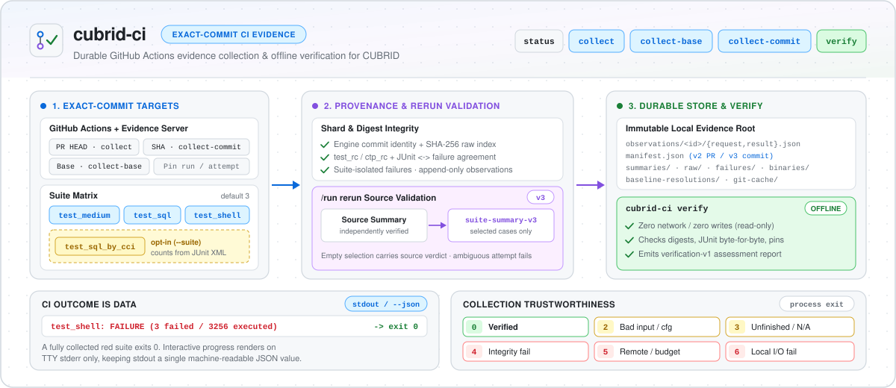

<div align="center">

<picture>
  <source media="(prefers-color-scheme: dark)" srcset="assets/readme/hero-dark.svg">
  <source media="(prefers-color-scheme: light)" srcset="assets/readme/hero-light.svg">
  
</picture>

# cubrid-ci

**Durable, exact-commit GitHub Actions evidence collection and offline verification for CUBRID.**

[Why this exists](#why-this-exists) ·
[Requirements](#requirements) ·
[Suites](#suites) ·
[Commands](#commands) ·
[Exit codes](#exit-codes) ·
[Validation and reruns](#shard-validation-and-rerun-lineage) ·
[Historical & baselines](#historical-commits-and-pr-baselines) ·
[Offline verify](#verifying-retained-evidence) ·
[Storage & schemas](#evidence-storage) ·
[Development](#development-and-release)

</div>

---

## Why this exists

CI analysis tools and AI agents fail silently when status checks are read from mutable PR labels, mixed across commits, or parsed from partial rerun logs without provenance. `cubrid-ci` turns CUBRID GitHub Actions runs into **cryptographically bound, replay-verifiable local evidence** without coupling collection to failure diagnosis:

- **Exact-commit pinning** — binds every collected suite to a 40-character Engine SHA, run ID, and attempt; never scans repository-wide workflows or invents PR-attached state.
- **Merge-base baselines & historical SHAs** — resolves exact PR merge bases via `git merge-base --all` (`collect-base`) and inspects arbitrary historical commits (`collect-commit`) with the same validation pipeline as PR collection.
- **`/run rerun` source lineage (`v3`)** — preserves selected-case rerun results alongside an independently validated source summary ([`suite-summary-v3`](schema/suite-summary-v3.schema.json)) so partial reruns are never mistaken for full-suite counts.
- **CI outcome vs. collection trustworthiness** — a fully collected red suite exits `0` because **CI outcome is data** (stdout / `--json`), while process exit codes (`0`, `2`–`6`) strictly report whether the evidence itself is complete and trustworthy.
- **Zero-network offline verification** — `verify` re-audits digests, JUnit byte-for-byte failure excerpts, binary budgets, rerun lineage, and PR/baseline pins read-only from disk.

| Subcommand | Purpose | Network | Mutates evidence root |
|---|---|---|---|
| `status` | Show PR status snapshot via `cubrid-pr-status` | GitHub | No |
| `collect` | Collect exact-commit GitHub Actions evidence for a PR head | GitHub + evidence server | Yes |
| `collect-commit` | Collect existing CI evidence for any 40-char Engine SHA | GitHub + evidence server | Yes |
| `collect-base` | Resolve PR merge base via `git` and collect its existing CI | GitHub + `git` + evidence server | Yes |
| `verify` | Audit a saved result and retained bundle against pins offline | None (offline) | No |
| `doctor` | Validate local dependencies and effective configuration | Local checks | No |

---

## Requirements

- **Rust 1.85+** for development; releases use the pinned **Rust 1.89.0** toolchain
- **`gh`**, authenticated for GitHub API access
- **`cubrid-pr-status`** for `status` and PR-head `collect`
- **`git`** for `collect-base`
- **Access to the internal evidence server** for terminal testcase evidence

Run `cubrid-ci doctor` to validate the local setup.

---

## Suites

| Suite | Default selection | Count source | Notes |
|---|---|---|---|
| `test_medium` | Included | `summary_info` | Default suite |
| `test_sql` | Included | `summary_info` | Default suite |
| `test_shell` | Included | `summary_info` | Default suite |
| `test_sql_by_cci` | **Opt-in** (`--suite test_sql_by_cci`) | JUnit XML | Publishes no `summary_info` |

`test_sql_by_cci` is opt-in: without `--suite`, `collect`, `collect-commit`, `collect-base`, and `verify` use the other three suites (`test_medium`, `test_sql`, `test_shell`), because `develop` commits carry no `test_sql_by_cci` status and a default request would leave every merge-base baseline incomplete. Pass `--suite test_sql_by_cci` to add it. A `test_sql_by_cci` shard publishes no `summary_info`, so its counts come from its JUnit XML, as in the workflow.

---

## Commands

### Inspect PR status & collect PR head

```sh
# Show the PR associated with the current CUBRID worktree.
cubrid-ci status

# Show a specific PR.
cubrid-ci status 7990

# Collect the default suites for local HEAD; local HEAD must equal the published PR head.
cubrid-ci collect

# Collect an explicit PR and exact commit.
cubrid-ci collect 7990 --commit <40-character-sha>
```

### Collect historical commits & PR merge-base baselines

```sh
# Collect an arbitrary historical Engine commit, independently of a PR head.
cubrid-ci collect-commit <40-character-sha> --json

# Pin a PR head/target, resolve their merge base, and collect baseline CI.
cubrid-ci collect-base 7990 --json

# Choose an explicit historical run (Engine identity is still verified).
cubrid-ci collect-commit <sha> --run-id <run-id> --suite test_sql --json
```

### Wait, tune concurrency & opt in to abnormal-shard binaries

```sh
# Collect a subset, optionally waiting for terminal states.
cubrid-ci collect 7990 --commit <sha> \
  --suite test_sql --suite test_medium --wait --timeout 26h

# Override the measured collection-wide HTTP concurrency ceiling.
cubrid-ci collect 7990 --commit <sha> --fetch-concurrency 40

# Opt in to bounded artifacts from abnormal shards.
cubrid-ci collect 7990 --commit <sha> --include-binaries \
  --max-binary-bytes 268435456 --max-binary-total-bytes 536870912
```

### Verify retained evidence offline

```sh
# Verify a saved collection result and its retained evidence offline.
cubrid-ci verify result.json --pr 7990 --pr-head <sha> --json

# Locate the interrupted observation of a collection that printed nothing.
cubrid-ci verify empty.json --pr 7990 --pr-head <sha> \
  --since 2026-11-03T08:00:00Z --json
```

### Timeouts, machine output & terminal progress

- **GitHub API timeout**: GitHub job log and job-list requests time out after **120 seconds**. Set `CUBRID_CI_GH_TIMEOUT` to a positive duration such as `30s` to change this limit. The `--timeout` option controls only the wait for suite completion.
- **Machine-readable output**: All commands accept `--json`. A fully collected red suite exits successfully (`0`): CI outcome is data, while the process exit reports collection completeness and trustworthiness.
- **Human-readable output**: Reports each suite's CI outcome and trusted test counts — for example, a red suite may appear as `test_shell: FAILURE (3 failed / 3256 executed)` while the collection command still exits `0`. Use `--json` when a stable machine-readable result is required.
- **Progress rendering**: When `stderr` is an interactive terminal, collection progress is rendered in place on one `stderr` line. Redirected `stderr` and `stdout` remain free of progress output, so `--json` continues to emit one machine-readable value on `stdout`.

---

## Exit codes

| Exit | Meaning |
|---:|---|
| `0` | Requested terminal evidence was validated and collected (or verified by `verify`) |
| `2` | Invalid input or configuration |
| `3` | Unfinished, expired, or job-level evidence unavailable (or interrupted/unselected/partial/unpinned/superseded in `verify`) |
| `4` | Identity, integrity, or malformed-evidence failure (or contradiction with pins in `verify`) |
| `5` | Remote access or configured-size failure |
| `6` | Local storage or serialization failure (or local read failure in `verify`) |

---

## Shard validation and rerun lineage

### Shard completion records

Shard completion records support the workflow's `test_rc` field and the legacy `ctp_rc` field:

- Conflicting fields and malformed exit codes fail validation.
- Exit code `1` permits collection **only** when the shard reports failed testcases; assigned counts, JUnit records, and the failed-case inventory must still agree.
- Other nonzero exit codes remain job-level failures.

### `/run rerun <source-run-id>` executions

- Retain their actual selected-case results and link to an independently validated source summary.
- A suite with no selected or changed cases carries forward the source verdict with zero newly executed cases.
- **Partial rerun counts are not full-suite counts.**
- Collection remains incomplete if the source cannot be validated, its attempt is ambiguous, or an empty selection changed or removed source cases.
- Rerun executions use [`suite-summary-v3`](schema/suite-summary-v3.schema.json); ordinary executions keep [`suite-summary-v2`](schema/suite-summary-v2.schema.json).

---

## Historical commits and PR baselines

### `collect-commit`: arbitrary Engine commits

`collect-commit` verifies a full 40-character Engine SHA and follows paginated exact-commit statuses and GitHub Actions check links:

- For each requested suite, it selects the **greatest linked run ID**, then **report timestamp**, **source**, and **record ID**, and pins that run's latest attempt.
- A newer running attempt remains incomplete even if an older status passed.
- Selection retains its time, candidates, run metadata, and discovery coverage; run attempts and state are checked again before publishing.
- **No repository-wide workflow scan is performed**: absent exact links mean `not_observed`, not proof that the commit never ran CI. API access failures mean incomplete discovery, not an empty successful search.

Use `--run-id` to select a candidate outside those links:

- Workflow revision, run title, and event do not prove the tested Engine; every completed suite must pass the same build/testcase provenance, count, verdict, and digest validation as PR collection.
- Explicit selection derives the suite outcome from producer verdict and testcase evidence instead of inventing a commit-attached status. Dispatched runs and reused builds are supported.
- `--attempt` requires `--run-id`; a historical attempt can only reuse an existing validated local bundle in the commit evidence root because remote suite files are not attempt-addressable. Missing or damaged cached evidence never falls back to current files labeled as the old attempt.

### `collect-base`: PR merge-base baselines

`collect-base` reads a CUBRID PR once, pins its actual head and target SHAs, and executes `git merge-base --all`:

- Supports `feature/*` targets as well as `develop`.
- Uses the bare Git cache at `<data-dir>/git-cache/CUBRID-cubrid.git` by default; `--git-cache` overrides it.
- Fetches missing ancestry by pinned SHA without changing working branches or refs.
- Zero or multiple bases are unresolved; pinned requests and results are retained in `<data-dir>/baseline-resolutions` even when history resolution fails.
- A successful evidence selection records PR number, head/target refs and SHAs, merge base, and observation time. Compare that head with any independently collected head snapshot before analysis.

### Shared behavior

Both `collect-commit` and `collect-base` accept repeated `--suite`, `--data-dir`, `--artifact-base`, `--fetch-concurrency`, and `--json`. They observe existing CI once; they do not trigger or wait for CI. Signature matching and causal interpretation remain in the analysis skills.

---

## Verifying retained evidence

`verify` reads only the evidence root. It never calls `gh`, the status command, or the evidence server, and it writes nothing. Pass the saved `stdout` of `collect`, `collect-commit`, or `collect-base`, the same `--suite` filters, and the pinned `--pr` and `--pr-head`. For a baseline, the pins must match the recorded baseline relationship.

### Observation lookup & integrity checks

1. Selects the unique observation whose terminal command equals the saved result. If the result is empty or a structured error, `--pr`, `--pr-head`, and `--since` select the unique PR-head observation started at or after that time (it can be interrupted or failed).
2. Validates observation schemas and identities, binary-budget arithmetic, and manifest agreement.
3. Validates every requested completed suite:
   - Raw index, digests, and byte lengths
   - Summary schema and identity, and count agreement
   - Failure files checked against the indexed JUnit (message byte for byte, `id` a safe unique path segment, `diff` an ordered excerpt of the message)
   - Binary inventory and complete rerun lineage
4. Rejects symlinked or escaping paths. Collection reuses the same summary check before trusting a warm summary.

### Verification report & exit semantics

The [`verification-v1`](schema/verification-v1.schema.json) report includes an `assessment` (observation, manifest, summary, identity, and suite-set facts), a per-suite result, an exact-baseline state for `collect-base` bundles (requires `--pr` and `--pr-head`), and `issues`:

- `0`: fully verified evidence
- `3`: unfinished, interrupted, failed, unselected, partial, unpinned, or superseded evidence
- `4`: contradiction in retained evidence or with the pins
- `6`: local read failure
- `2`: invalid input

Verification establishes **integrity only**; it never establishes CI causality.

---

## Evidence storage

### Root directory & fetch concurrency

- **Evidence root**: defaults to `~/.local/share/cubrid-ci-data`. Override with `--data-dir`, `CUBRID_CI_DATA_DIR`, or `~/.config/cubrid-ci/config.toml`, in that precedence order.
- **Fetch concurrency**: defaults to `40` and is shared by every suite, shard, text response, and optional binary response. Override with `--fetch-concurrency`, `CUBRID_CI_FETCH_CONCURRENCY`, or `fetch_concurrency` in the TOML configuration, in that precedence order. `cubrid-ci doctor` reports the effective value and source. See [`docs/benchmarks/collection-fetch-concurrency-2026-09-23.md`](docs/benchmarks/collection-fetch-concurrency-2026-09-23.md).

### Suite isolation & directory layout

A mandatory acquisition failure stops new shards only in the affected suite. Already-running shards finish, and independent suites continue under the shared concurrency ceiling. Complete suite evidence remains available even when another suite makes the overall collection incomplete.

- **PR collection**: stores GitHub Actions evidence by PR, commit, run, attempt, and suite.
- **Commit & baseline collection**: stores evidence under `github-actions/CUBRID-cubrid/commits/<sha>` with the same run/attempt layout.

### Schema versions & append-only observations

| Artifact / path | PR `collect` | `collect-commit` / `collect-base` | Notes |
|---|---|---|---|
| Command result & `manifest.json` | v2 | v3 | v3 carries commit `selection` & optional baseline; atomically records latest executions |
| Observation (`request.json` / `result.json`) | v1 | v2 | Append-only under `observations/<observation-id>/` |
| Raw index & failure records | v2 | v2 | Raw index binds the validated suite summary digest |
| Suite summary | v2 (ordinary) / v3 (rerun) | v2 (ordinary) / v3 (rerun) | Warm summary is never reused if either side's digest diverges |
| Historical CircleCI bundles | v1 | v1 | Recognized for compatibility; never produced or rewritten |

See [`schema/README.md`](schema/README.md) for the full JSON Schema inventory.

Each invocation creates an append-only `observations/<observation-id>/request.json` before acquisition and adds `result.json` on terminal completion. The observation records canonical suite and shard acquisition states, effective fetch configuration, diagnostics, and command-wide binary-budget consumption. Incomplete response reads retain their stage, endpoint, consumed byte count, and diagnostic without publishing the temporary body. A `request.json` without a `result.json` identifies an interrupted local collection; it does not label the provider execution or a suite as failed.

---

## Development and release

```sh
just verify
./scripts/build-release.sh
./scripts/verify-release-reproducibility.sh
```

Version `0.2.0` exposes `status`, `collect`, `collect-commit`, `collect-base`, `verify`, and `doctor`. Legacy suite-specific CircleCI commands are unsupported.
